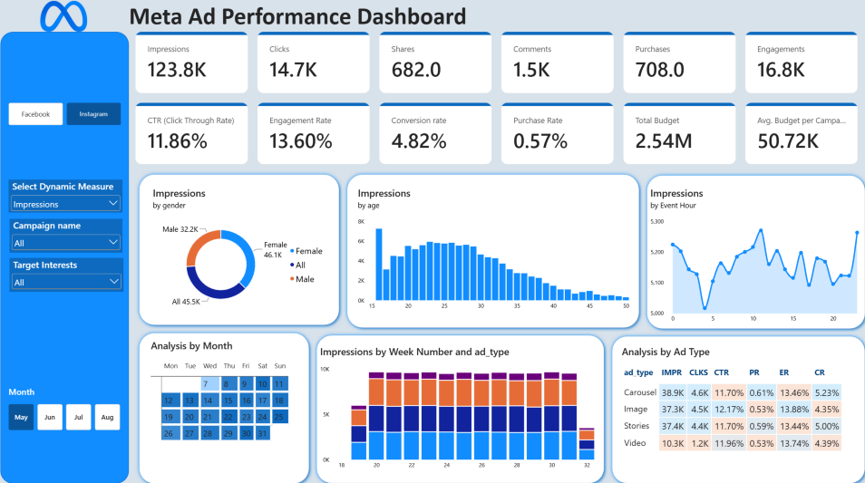

# 📊 Meta Ads End-to-End Performance Analytics Dashboard

[](https://app.powerbi.com/view?r=eyJrIjoiODgwMWJlYjctODRlNC00ZWFmLWFkZDMtNmM1Yjk5MjA1OTkwIiwidCI6IjUxMzRkZDExLWZlNDEtNGY3My1iODIyLTg0NDljN2Y1MzA4MCJ9)


An interactive, enterprise-grade **Power BI Marketing Analytics & Media Buying Intelligence Dashboard** engineered to evaluate cross-platform advertising efficiency, diagnose full-funnel conversion leakage, and optimize capital allocation across **400,000 ad events**, **50 multi-channel campaigns**, and **$2.54M in total ad spend** across Meta platforms (**Facebook & Instagram**).

> 🔗 **Live Interactive Report**: [Click here to view the live published dashboard](https://app.powerbi.com/view?r=eyJrIjoiODgwMWJlYjctODRlNC00ZWFmLWFkZDMtNmM1Yjk5MjA1OTkwIiwidCI6IjUxMzRkZDExLWZlNDEtNGY3My1iODIyLTg0NDljN2Y1MzA4MCJ9)

---

## 📌 Business Problem & Objectives

### The Business Context
In cross-platform digital advertising operations, performance marketing teams face a constant strategic challenge: **maximizing purchase conversion efficiency while mitigating ad spend waste and delivery leakage**. Without centralized business intelligence, media buyers and marketing executives face significant operational blind spots:

1. **Cross-Platform Format Misalignment**: Applying uniform creative formats across Facebook and Instagram feeds without recognizing platform-specific user consumption behaviors.
2. **Pacing Inefficiencies & Lack of Dayparting**: Serving ad impressions evenly 24/7, failing to align ad spend with peak high-intent purchasing hours.
3. **Unit Economic Bleed**: Lacking real-time visibility into campaign-level CAC variance, allowing underperforming campaigns to drain hundreds of thousands of dollars in capital.

### The Analytical Solution
This Power BI reporting system was engineered to deliver actionable, data-driven answers across two core analytical levels:
* **Facebook & Instagram Dedicated Performance Pages**: Isolated channel views to benchmark click-through rates (CTR), engagement rates (ER), and conversion rates (CVR) side-by-side.
* **Interactive Dayparting & Calendar Tooltip Engine**: Hourly area distribution charts and a custom **Calendar Heatmap Matrix** equipped with dynamic report-page hover tooltips for granular daily KPI audits.
* **Dynamic Parameter Switching**: Integrated **Field Parameters** (`Select Dynamic Measure`) enabling users to toggle charts dynamically between volume counts (Impressions, Clicks, Purchases) and efficiency ratios (CTR, CVR, Engagement Rate) without visual clutter.

---

## 🖼️ Dashboard Preview

| Facebook Performance View (Scale & Conversion Lead) | Instagram Performance View (Engagement & Creative Formats) |
| :---: | :---: |
|  |  |

---

## 📈 Key Performance Indicators (KPI Summary)

### 1. Overall Portfolio Scale
| Metric | Measure Name | Portfolio Total | Facebook | Instagram | Variance / Channel Insight |
| :--- | :--- | :---: | :---: | :---: | :--- |
| **Delivered Impressions** | `[Impressions]` | **339,812** | **215,972** (63.6%) | **123,840** (36.4%) | High volume channel: FB |
| **Total Clicks** | `[Clicks]` | **40,079** | **25,389** | **14,690** | 11.79% blended CTR |
| **Click-Through Rate (CTR)** | `[CTR (Click Through Rate)]` | **11.79%** | **11.76%** | **11.86%** | **Instagram +0.10% higher CTR** |
| **Total Engagements** | `[Engagements]` | **46,144** | 29,353 | 16,791 | Shares + Clicks + Comments |
| **Engagement Rate (ER)** | `[Engagement Rate]` | **13.58%** | 13.59% | 13.56% | Balanced engagement |
| **Completed Purchases** | `[Purchases]` | **2,031** | **1,323** (65.1%) | **708** (34.9%) | **Facebook drives 65% of sales** |
| **Conversion Rate (CVR)** | `[Conversion rate]` | **5.07%** | **5.21%** | **4.82%** | **Facebook +8.1% more efficient** |
| **Total Ad Budget** | `[Total Budget]` | **$2,535,923.78** | — | — | 50 active campaigns |

---

## 🔍 Deep Analytical Insights

### 1. Platform-Specific Creative Affinities (Stories vs. Carousels)
* **The Finding**: While Instagram generated higher click interest (+0.10% CTR), Facebook dominated bottom-of-funnel sales conversion (5.21% vs 4.82% CVR).
* **Format Divergence**:
  * **On Facebook**, **Stories** was the highest-converting format (**5.52% CVR**, 464 purchases), followed by **Video** (**5.22% CVR**, 284 purchases).
  * **On Instagram**, **Carousel** ads delivered the highest conversion rate (**5.23% CVR**, 238 purchases), outperforming Stories (5.00% CVR).
  * Across **both platforms**, standard **Static Images** produced the lowest conversion efficiency (4.91% on FB, 4.35% on IG).
* **Strategic Recommendation**: Stop syndicating identical creatives across platforms. Shift Instagram creative budget toward multi-slide Carousels and concentrate Facebook production on vertical Story/Reel experiences.

> 📌 **Resume Highlight**:  
> * **Uncovered platform-specific creative affinities:** Demonstrated that **Stories** drove peak conversion on Facebook (**5.52% CVR, 464 purchases**), while **Carousel ads** outperformed on Instagram (**5.23% CVR, 238 purchases**), identifying format-specific budget optimization strategies.

---

### 2. Full-Funnel Drop-Off: High Engagement vs. Post-Click Conversion Leakage
* **The Finding**: Despite top-decile engagement on both platforms (~**11.8% CTR**, **13.58% engagement rate**), over **94.9% of user traffic dropped off post-click**, resulting in a low **5.07% blended conversion rate** and a **0.60% overall purchase rate**.
* **Cross-Platform Breakdown**:
  * **Facebook**: Delivered **25.4K clicks** (**11.76% CTR**) and converted **1,323 purchases** (**5.21% CVR**).
  * **Instagram**: Drove higher click-through engagement (**14.7K clicks**, **11.86% CTR**), but lower purchase conversion (**708 purchases**, **4.82% CVR**).
* **Strategic Recommendation**: Because top-of-funnel creative appeal was strong, the drop-off bottleneck was concentrated post-click. Recommended streamlining landing page checkout flows, reducing mobile checkout friction, and deploying segmented retargeting to capture the ~95% of traffic abandoning checkout.

> 📌 **Resume Highlight**:  
> * **Identified post-click conversion drop-off across Facebook and Instagram:** Despite strong engagement on both platforms (**~11.8% CTR**), only **5.2% of Facebook clicks** (1,323 purchases) and **4.8% of Instagram clicks** (708 purchases) converted into sales, revealing significant checkout friction and guiding landing page optimization.

---

## 🛠️ Data Architecture & Modeling

The reporting model is structured as an optimized **Star Schema** to ensure high query performance and seamless cross-filtering:

```text
       ┌──────────────┐         ┌──────────────┐
       │   campaigns  │         │    users     │
       │  (Dimension) │         │ (Dimension)  │
       └──────┬───────┘         └──────┬───────┘
              │ 1                      │ 1
              │                        │
              │ *                      │ *
       ┌──────┴───────┐         ┌──────┴───────┐
       │     ads      ├─────────┤   ad_events  │
       │  (Dimension) │ 1     * │    (FACT)    │
       └──────────────┘         └──────┬───────┘
                                       │ *
                                       │
                                       │ 1
                                ┌──────┴───────┐
                                │Calendar Table│
                                │ (Dimension)  │
                                └──────────────┘
```

* **Fact Table**:
  * `ad_events` (400,000 records): Event transactions capturing timestamps, platform, user IDs, event types (`Impression`, `Click`, `Share`, `Comment`, `Purchase`), day of week, and event hour.
* **Dimension Tables**:
  * `ads` (200 records): Ad metadata including `campaign_id`, `ad_platform`, `ad_type`, `target_gender`, `target_age_group`, and `target_interests`.
  * `campaigns` (50 records): Campaign metadata, flight dates, duration in days, and total budget allocations.
  * `users` (9,841 records): User demographic data including age, age group, gender, country, location, and user interest profiles.
  * `Calendar Table`: Automated date dimension providing month names, week numbers, day names, and chronological sort keys.
* **Disconnected Utility Table**:
  * `Select Dynamic Measure`: Disconnected field parameter table supporting dynamic measure selection in dashboard visual headers.

---

## 📂 Repository Structure

```text
├── assets/
│   ├── facebook_view.png                   # Facebook Analytics Page preview
│   └── instagram_view.png                  # Instagram Analytics Page preview
├── Meta_ads_analytics.pbix                 # Full interactive Power BI Desktop workbook (12.3 MB)
├── DAX_Measures.md                         # Complete catalog of DAX formulas & logic
├── .gitignore                              # Git exclusion rules for Power BI temporary files
└── README.md                               # Project documentation & insight breakdown
```

---

## 🚀 How to Open and Explore

1. Clone this repository (or download as ZIP from the green Code button above):
   ```bash
   git clone https://github.com/Curious011/Meta-Ads-Performance-Analytics-PowerBI.git
   ```
2. Download and install [Power BI Desktop](https://powerbi.microsoft.com/desktop/) (free).
3. Open `Meta_ads_analytics.pbix`.
4. Interact with the slicers, date table filters, and dynamic measure toggle buttons!

---

## 👤 Author
* **Harsh Sharma**
* **Project**: Meta Ads End-to-End Performance Analytics
* **Tools**: Power BI, DAX, Power Query, Marketing Data Analysis
